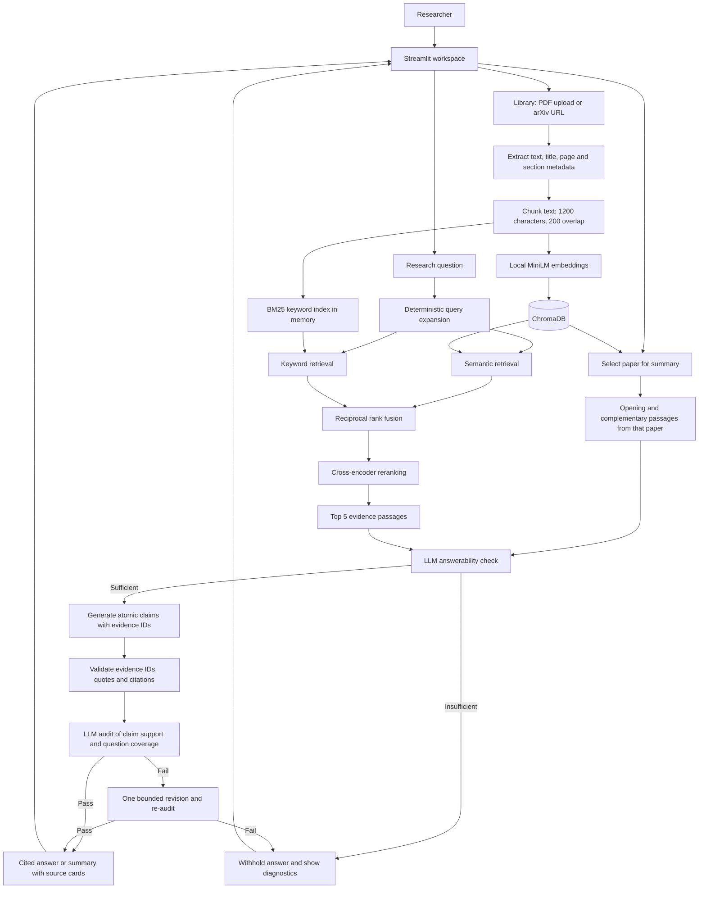

# Citation-Grounded AI Research Assistant

**Paper Desk** turns research PDFs into a searchable workspace. Ask technical questions, inspect the passages behind each answer, and generate cited paper summaries using your own LLM provider.

Built with **Python · Streamlit · ChromaDB · Sentence Transformers · BM25**.

> **Live demo:** Deployment pending. The verified public URL will be added here after Streamlit Community Cloud finishes deploying.

## What you can do

- **Research:** Ask questions across your indexed papers and inspect inline citations, source snippets, PDF pages where available, and retrieval scores.
- **Library:** Upload text PDFs or ingest arXiv URLs; browse papers by title and open a summary from the library.
- **Paper Summary:** Generate an evidence-grounded overview of a selected paper, with links to supporting passages.
- **Bring your own model:** Connect Groq, OpenAI, Anthropic, Google Gemini, or an allowed OpenAI-compatible endpoint with your own API key.
- **Inspect the evidence:** Download answer/summary JSON and inspect verification diagnostics when an answer is withheld.

The app withholds answers when the selected evidence or verification is insufficient. This reduces unsupported claims; it is not a proof of factual accuracy.

## Architecture



### How retrieval and verification work

1. **Ingest:** Extract text from text-based PDFs, attach metadata, split it into overlapping chunks, and assign deterministic IDs to avoid duplicate ingestion of identical chunks.
2. **Retrieve:** Search local dense embeddings and BM25 keyword matches. Each branch considers up to 150 results; reciprocal rank fusion combines candidates.
3. **Rerank:** Score query–passage pairs with `cross-encoder/ms-marco-MiniLM-L-6-v2` and select up to five passages. Certain compound questions run complementary searches.
4. **Ground:** Ask the selected LLM whether the evidence answers the question, then draft atomic claims linked to evidence IDs.
5. **Verify:** Check source references and quote consistency, then use the LLM to audit claim support and coverage. A rejected audit can trigger one revision before the answer is withheld.
6. **Present:** Show the answer with citations and inspectable evidence. Relevance scores are not calibrated confidence probabilities.

Embeddings use `sentence-transformers/all-MiniLM-L6-v2` on CPU. Paper summaries use a separate selection path restricted to the chosen paper. Query rewriting is deterministic; it does not require another LLM call.

## Try it locally

Use Python 3.11, matching the Docker configuration:

```bash
python -m venv .venv
source .venv/bin/activate
python -m pip install -r requirements.txt
python -m streamlit run app.py
```

Open **http://localhost:8501**. On Windows, activate with `.venv\Scripts\activate`.

1. Open **Library** and add a PDF or `https://arxiv.org/abs/1706.03762`.
2. In **Connect your AI provider**, choose your provider, enter its model ID and your API key, and test the connection.
3. Ask **“What is the main contribution of the Transformer architecture?”** in Research.
4. Open the cited passages to check the answer, or click the paper title to generate a summary.

A fresh installation starts with an empty library. The title catalog is metadata, not a preloaded paper database. First use downloads the local embedding/reranking models. Model calls, including verification and summaries, consume your provider quota.

## Deploy to Streamlit Community Cloud

1. Push this repository to GitHub.
2. Sign in at [Streamlit Community Cloud](https://share.streamlit.io/) and choose **Create app**.
3. Select repository **`sivanishwanthm/RAG-Research-Assistant`**, branch **`main`**, and entrypoint **`app.py`**.
4. In **Advanced settings**, select **Python 3.11**. No server LLM key is needed: users enter their own keys in the sidebar.
5. Choose an available app subdomain, deploy, and wait for the app to load successfully.
6. In the hosted app, ingest a paper, connect your model, ask a question, inspect citations, and generate a summary. Copy the actual public URL into this README only after those checks pass.

The root `requirements.txt` loads the app dependency pins from `requirements-app.txt`. Notebook dependencies are separate in `requirements-notebook.txt`.

[Official deployment guide](https://docs.streamlit.io/deploy/streamlit-community-cloud/deploy-your-app/deploy) · [Dependency setup](https://docs.streamlit.io/deploy/streamlit-community-cloud/deploy-your-app/app-dependencies)

### Hosting considerations

- The Chroma library is shared by all users of an app instance. Upload only papers intended to be shared; there is no per-user document isolation.
- Treat the hosted local database as rebuildable. Keep original papers and use persistent storage for a durable deployment.
- Model downloads, CPU reranking, and an in-memory keyword index consume host memory. Verify resource usage with your intended corpus before sharing widely.
- API keys stay in Streamlit session memory and pass through the app server to the selected provider. Retrieved passages also go to that provider. Keys are excluded from exports and Git.
- Public untrusted uploads need stronger parser isolation and per-user quotas. This repository is a portfolio/trusted-team app, not a hardened multi-tenant service.
- Optional OIDC access control and Docker deployment are documented in [APP_README.md](APP_README.md).

## Docker

```bash
docker compose up --build -d
```

Open **http://localhost:8501**. The Compose configuration uses one app instance with mounted Chroma storage and model cache. Docker has not been validated in the current development environment.

## Project map

| File | Responsibility |
| --- | --- |
| `app.py` | App layout, research UI, provider settings and session state |
| `app_workspaces.py` | Library and paper summary workflows |
| `app_backend.py` | Ingestion orchestration, hybrid search and summary evidence selection |
| `paper_ingestion.py` | PDF extraction, arXiv ingestion, metadata and chunk IDs |
| `grounded_answer.py` | Answerability, evidence validation, claim auditing and refusal |
| `llm_provider.py` | Provider adapters and custom endpoint restrictions |
| `app_access.py` | Optional authentication and email allowlist |
| `tests/` | UI, retrieval, grounding, ingestion and provider regression tests |
| `RAG Implementation.ipynb` | Original experimental RAG and evaluation notebook |

## Validation

```bash
python -m unittest discover -s tests -q
```

The latest local run passed **77 tests**. Most provider tests use mocked responses; this does not establish live answer accuracy across all models. Evaluation helpers remain in the repository, but Evaluation is no longer an app tab. Review answers against the cited passages and maintain a labeled test set for retrieval and grounding quality.

For detailed setup, privacy behavior and troubleshooting, see [APP_README.md](APP_README.md).
